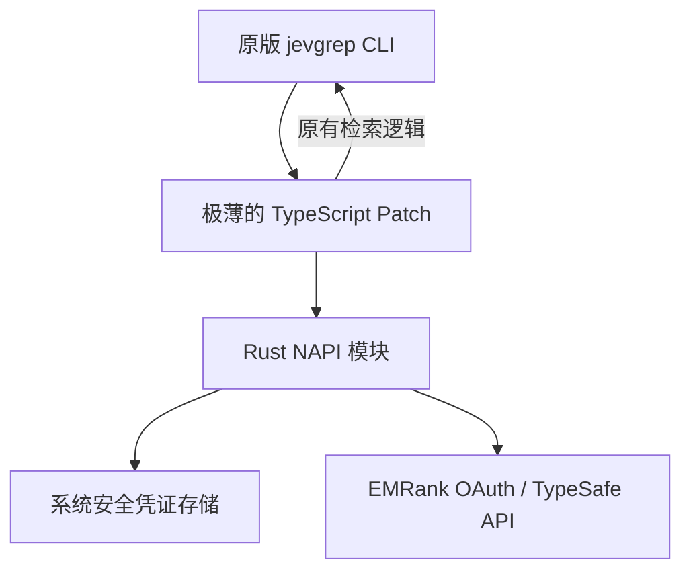

**保留原版 `jg` 的全部用法；额外提供 `jg emrank --login`；认证与 DPoP 的核心逻辑用 Rust + N-API；上游改动以最小 patch 维护。** 


**我要的是一个长期跟踪上游的 jevgrep 定制发行版：在原版 `jg` 上叠加 EMRank OAuth 功能，新增逻辑主要用 Rust + NAPI-RS 实现，并通过 Git Patch 持续跟进上游更新。**

期望的用户体验是：

```powershell
# 原版功能全部保留
jg auth
jg doctor
jg "Where is authentication implemented?" .

# EMRank 扩展
jg emrank --login
jg emrank --status
jg emrank --logout
jg "Where is authentication implemented?" .
```

这样原有 Provider 和 EMRank OAuth 可以共存。

## 一、现有源码已经有合适的 Patch 切入点

当前 jevgrep 的几个关键文件：

| 上游文件 | 当前职责 | 我们需要做的事 |
|--------|--------|--------|
| [apps/cli/src/args.ts](https://github.com/dzhng/jevgrep/blob/main/apps/cli/src/args.ts) | CLI 参数解析 | 尽量不动，提前识别 `emrank` 子命令 |
| [apps/cli/src/index.ts](https://github.com/dzhng/jevgrep/blob/main/apps/cli/src/index.ts) | 命令分发、创建 Evaluator | 增加 EMRank 命令入口及调用 NAPI |
| [packages/core/src/evaluator.ts](https://github.com/dzhng/jevgrep/blob/main/packages/core/src/evaluator.ts) | TypeSafe 模型请求 | **暂时不需要修改** |
| [packages/core/src/providers.ts](https://github.com/dzhng/jevgrep/blob/main/packages/core/src/providers.ts) | Provider 配置 | **暂时不需要修改** |
| [scripts/build-cli.ts](https://github.com/dzhng/jevgrep/blob/main/scripts/build-cli.ts) | Bun 构建 Node CLI | 将 NAPI 包设为外部依赖 |
| [apps/cli/package.json](https://github.com/dzhng/jevgrep/blob/main/apps/cli/package.json) | npm 打包与依赖 | 增加原生包依赖、定制包标识 |

最重要的发现是：

```typescript
createEvaluator({
  provider,
  apiKey,
  baseURL,
  model,
  fetch, // 已经支持自定义 fetch
  signal,
});
```

上游的 `createEvaluator()` 已经允许注入自定义 `fetch`。

因此，**以在现有网络请求入口增加 DPoP 签名，而不必 Fork 或重写整个 Evaluator。**


## 二、Rust + NAPI 组织

我建议采用这样的分层：



核心原则是：

**TypeScript Patch 只负责调用原生模块，OAuth、DPoP、凭证管理和签名算法全部放在 Rust 中。**

NAPI-RS 本身支持将 Rust 异步函数暴露为 Node.js Promise，也支持针对不同平台构建原生插件。 [NAPI-RS](https://napi.rs/docs/introduction/getting-started?utm_source=chatgpt.com) [NAPI-RS](https://napi.rs/docs/more/support-compatibility?utm_source=chatgpt.com)

### Rust 模块的职责

建议模块名称为 `@emrank/jevgrep-native`。

Rust 对外暴露的接口可以设计为：

```rust
#[napi]
pub async fn login() -> napi::Result<LoginInfo>;

#[napi]
pub async fn logout() -> napi::Result<()>;

#[napi]
pub async fn status() -> napi::Result<AuthStatus>;

#[napi]
pub async fn authorize_request(
    method: String,
    url: String,
) -> napi::Result<AuthHeaders>;
```

内部结构：

```text
native/
├── Cargo.toml
└── src/
    ├── lib.rs
    ├── oauth.rs
    ├── pkce.rs
    ├── dpop.rs
    ├── token.rs
    ├── storage.rs
    └── error.rs
```

主要工作：

- `oauth.rs`：浏览器登录、本地回调、Token Exchange。
- `pkce.rs`：OAuth PKCE。
- `dpop.rs`：密钥生成、DPoP JWT 签名、Nonce 处理。
- `token.rs`：Access Token 缓存和自动刷新。
- `storage.rs`：Windows DPAPI、其他系统凭证存储。
- `lib.rs`：NAPI 导出。

### 为什么仍然需要极少量 TypeScript？

这是必须说明的技术边界。

jevgrep 的命令入口本身是 TypeScript，最后由 Bun 构建成 Node.js CLI。

所以要让原版 CLI 识别：

```bash
jg emrank --login
```

至少要在命令分发处加入调用 NAPI 的入口。

但 OAuth 业务逻辑不需要写在 TypeScript 里。

同样，SDK 的 `fetch` 是 JavaScript Fetch API，Rust 可以通过 NAPI 返回签名后的请求头，再由原有网络层发送请求。

这意味着：

- Rust 负责生成 `Authorization` 和 `DPoP`。
- TypeScript 只负责把请求头交给 Fetch。
- Jevgrep 原有的超时、重试、并发、解析和检索流程全部保留。

从源码来看，这比重写 Provider 更合适。

还有一个细节：**上游 TypeSafe SDK 默认会填入 Bearer Header。EMRank 模式必须在自定义 Fetch 中替换该 Header，而不是简单追加 DPoP Header。**

---

## 三、Patch 最好控制在三个部分

第一版最多维护三组 Patch：

| Patch | 修改范围 | 用途 |
|--------|--------|--------|
| `0001-emrank-command.patch` | `apps/cli/src/index.ts` | 增加 `jg emrank` 命令入口 |
| `0002-emrank-transport.patch` | `apps/cli/src/index.ts` | EMRank 模式注入签名 Fetch |
| `0003-emrank-native-build.patch` | 构建脚本、CLI package.json | 外部加载 NAPI 原生包并打包 |


特别注意：

**尽量不改 `packages/core/src/evaluator.ts`、`packages/core/src/retrieve.ts` 和 `packages/core/src/providers.ts`。**

这些属于核心业务代码，上游修改频率和影响面都可能比较高。

另外，EMRank 和原 Provider 应该分别保存认证信息。

`jg emrank --login` 不能覆盖用户已有的 Vercel、OpenRouter 等 API Key。

对于缓存，首次登录、切换 EMRank 账号或退出登录时还需要考虑清理或隔离缓存，避免不同用户共享同一模型的本地结果。

---

## 四、上游同步：不要只用 Dependabot

**Dependabot 适合更新 npm、Cargo 依赖，但它不会帮你把上游源码更新后重新应用自定义 Patch。**


> 定时拉取 jevgrep 最新源码 → 应用我们的 Patch → 编译 Rust NAPI → 构建完整 CLI → 测试 → 提交更新 PR。

推荐独立 Overlay 仓库，而不是长期直接在 Fork 的 `main` 上堆修改。

### 推荐仓库结构

```text
emrank-jevgrep/
├── upstream.lock
├── patches/
│   ├── 0001-emrank-command.patch
│   ├── 0002-emrank-transport.patch
│   └── 0003-emrank-native-build.patch
├── native/
│   ├── Cargo.toml
│   ├── Cargo.lock
│   └── src/
├── scripts/
│   ├── check-upstream.sh
│   ├── apply-patches.sh
│   └── build.sh
├── tests/
│   ├── upstream-compat/
│   └── emrank/
└── .github/
    └── workflows/
        ├── upstream-check.yml
        ├── compatibility.yml
        └── release.yml
```

`upstream.lock` 记录目前验证通过的上游 Commit SHA。

发布时：

1. 检出该 SHA 对应的 jevgrep 源码。
2. 应用 `patches/`。
3. 构建 NAPI。
4. 构建定制 CLI。
5. 打包发行。

我们的仓库主要存放自己写的 Rust 代码和 Patch，不需要重复维护上游所有源文件。

### Patch 如何生成与应用？

首次修改完成后，通过：

```bash
git format-patch
```

生成 Patch 系列。

后续应用到新上游版本时：

```bash
git am --3way patches/*.patch
```

`--3way` 能在具备原始 Git 对象的情况下尝试三方合并；如果冲突无法解决，命令会失败并保留冲突供处理。 [git-am Documentation](https://git-scm.com/docs/git-am?utm_source=chatgpt.com)

关键在于：**Patch 不是每次都要人工重新制作。**

只要上游没有破坏相应接入点，就能自动重新应用。

---

## 五、GitHub Actions 定时同步策略

建议使用两种检查方式。

| 类型 | 检查频率 | 作用 |
|--------|--------|--------|
| Release 更新检查 | 每天 | 发现正式版本，尝试自动同步 |
| `main` 分支兼容性检查 | 每天 | 提前发现未来可能出现的 Patch 冲突 |

不推荐直接从上游 `main` 构建并自动发布给用户。

更好的做法是：正式版本作为发布依据，`main` 只用于兼容性预警。

### 工作流配置

`.github/workflows/upstream-check.yml` 的入口：

```yaml
name: Upstream Sync

on:
  schedule:
    - cron: "17 3 * * *"
  workflow_dispatch:

permissions:
  contents: write
  pull-requests: write

jobs:
  sync:
    runs-on: ubuntu-latest

    steps:
      - uses: actions/checkout@v4

      - name: Check upstream
        run: bash scripts/check-upstream.sh

      - name: Apply patches
        run: bash scripts/apply-patches.sh

      - name: Verify compatibility
        run: bash scripts/build.sh
```

上面是工作流骨架，三个脚本需要实现实际的版本检测、临时目录构建、错误报告和 PR 创建逻辑；正式使用时应固定第三方 Action 的 Commit SHA。

GitHub Actions 支持定时运行，但计划任务可能存在延迟，不应将它视为严格准时的调度器。 [GitHub Docs](https://docs.github.com/en/actions/reference/workflows-and-actions/workflow-syntax?utm_source=chatgpt.com)

### 自动同步结果如何处理？

1. **检测到上游新版本**
   
   读取 Release / Commit SHA，与 `upstream.lock` 比较。
2. **尝试应用 Patch**
   
   在临时工作目录检出新版本，执行 `git am --3way`。
3. **构建与测试**
   
   构建 Rust NAPI、完整 CLI，并运行原版功能回归测试及 EMRank OAuth / DPoP 测试。
4. **Patch 成功且测试通过**
   
   自动创建更新 `upstream.lock` 的 PR，附带版本差异、测试结果和新的构建产物信息。
5. **Patch 冲突或测试失败**
   
   不修改当前稳定版本，保留错误报告并通知维护者处理。

更新 PR 先由我审核，不要第一版就开启自动合并。


---

## 六、发布需要特别处理 NAPI

目前官方 jevgrep 通过 Bun 将 TypeScript 打包成 Node.js CLI。

NAPI 模块属于原生二进制，不能简单把 Rust 代码塞进 Bun bundle。

建议：

- 构建时将 `@emrank/jevgrep-native` 标记为 external。
- 通过 NAPI-RS 生成平台对应的 `.node` 文件。
- 使用平台专属 npm 包与 `optionalDependencies` 分发原生二进制。
- 构建完成后验证全新环境中的安装与加载。

NAPI-RS 官方已经提供对应的跨平台原生包发布流程。 [NAPI-RS](https://napi.rs/docs/deep-dive/release?utm_source=chatgpt.com)

Bun 官方文档示例 https://bun.com/docs/bundler/plugins#native-plugins

初期测试目标：

- Windows x64
- Linux x64（glibc）
- Linux x64（musl，如需要 Docker/Alpine）

之后扩展 macOS 和 ARM64。

最终的 npm 包可以命名为：

```text
@emrank/jevgrep
@emrank/jevgrep-native
```

前者提供 `jg` 命令，后者提供 Rust 原生能力。

用户安装定制发行版即可同时使用官方功能和 EMRank 扩展。不建议同时全局安装官方和定制版的 `jg`，因为会产生同名可执行文件冲突。

---

## 七、实施顺序

| 阶段 | 工作内容 | 验收目标 |
|--------|--------|--------|
| PR0 | 搭建 Overlay、Patch 与同步工作流 | 能从指定上游 SHA 自动构建 |
| PR1 | 增加 `jg emrank` 命令入口 | 原版所有命令不受影响 |
| PR2 | 集成 NAPI-RS 原生模块 | Windows/Linux 成功加载 |
| PR3 | Rust OAuth + PKCE | `jg emrank --login` 成功 |
| PR4 | Rust DPoP 与 Fetch 注入 | 正常完成 `/systemone` 请求 |
| PR5 | 多平台发行及自动上游同步 | 新版上游自动产生兼容性 PR |

**Patch 和上游同步放在 PR0**。

先搭好这套机制，再添加 OAuth 和 DPoP，后面的代码始终在受控的 Patch 范围内开发。

### 最终确定的技术边界

- 原版 `jg` 功能全部保留。
- 新增 `jg emrank --login` 等命令。
- OAuth、DPoP、Token 管理全部使用 Rust + NAPI-RS。
- TypeScript 只保留必要的命令分发和 Fetch 调用胶水。
- 核心检索逻辑不修改。
- 自定义修改以 Git Patch 系列管理。
- 每天检测上游更新，自动重新应用 Patch、构建和测试。
- 发布独立的 EMRank 定制 npm 包。


## 相关链接

jevgrep https://github.com/dzhng/jevgrep